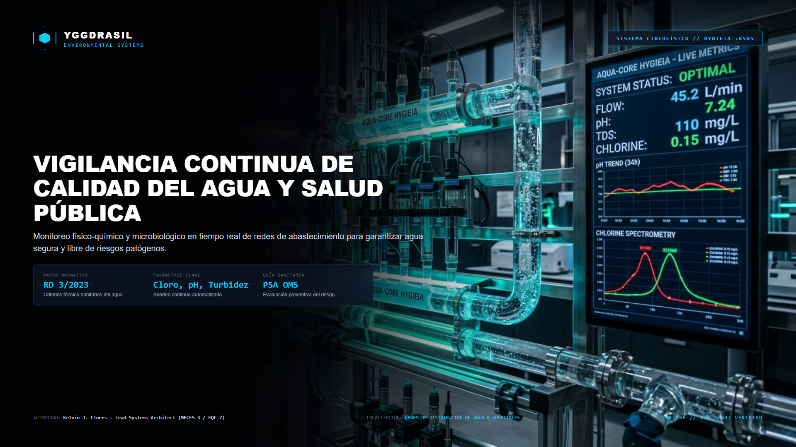

<div align="center">

  

  # AQUA-CORE: HYGIEIA™ V1
  ### Civil Cyber-Physical Digital Twin & Physics-Informed Neural Network (PINN) for Water Biosecurity

  [](https://doi.org/10.5281/zenodo.23321969)
  [](https://www.python.org/)
  [](https://pytorch.org/)
  [](https://yggdrasil-aqua-core-hygieia-kjfy.streamlit.app/)
  [-00E676.svg?style=flat-square)](https://www.boe.es/eli/es/rd/2023/01/10/3)
  [-10B981.svg?style=flat-square)](https://www.boe.es/eli/es/rd/2022/06/21/487)
  [](https://www.boe.es)
  [-A855F7.svg?style=flat-square)](https://digital-strategy.ec.europa.eu)
  [](https://opensource.org/licenses/MIT)

  <br/>

  **Lead Systems Architect & Environmental Engineer:**  
  **Kelvin Jesús Flores Yarihuamán** (MECES Nivel 3 · EQF Level 7)  
  *Yggdrasil Environmental Systems · Sovereign Biosecurity Platform*

</div>

---

> ### ⚖️ REGLA NÚMERO 0 DE TODO EL SISTEMA (AXIOMA SUPREMO DE EXISTENCIA):
> *"Jamás le vamos a poder ganar a la naturaleza, ni a la biología humana; quien no entienda esto, jamás podrá vivir."*  
> — **Kelvin Jesús Flores Yarihuamán**, Fundador y Director Técnico de Yggdrasil Environmental Systems.  
>  
> *Este es el cimiento **ontológico, biofísico y etológico** de todo el ecosistema: la tecnología, los sensores IoT, la termodinámica computacional y las redes neuronales informadas por la física no existen para violentar la biosfera ni forzar los límites fisiológicos del ser humano, sino para comprender sus leyes inmutables, alinearse con ellas y garantizar la resiliencia y soberanía del agua para el consumo humano.*

---

## 🌊 Resumen Ejecutivo & Misión Científica

**AQUA-CORE: HYGIEIA™** es una plataforma de **Gemelo Digital Ciberfísico** y Sistema de Soporte a la Decisión (DSS) orientada a la garantía integral de la **calidad del agua de consumo humano, el control microbiológico avanzado y la bioseguridad en redes de distribución e infraestructuras críticas**.

El sistema integra las normativas sanitarias y directivas más estrictas de España y la Unión Europea con modelos mecanicistas de advección-reacción y **Redes Neuronales Informadas por la Física (PINN)**. Esto permite predecir el decaimiento de desinfectantes residuales, la formación de subproductos cancerígenos (Trihalometanos - THMs) y nichos de proliferación bacteriana (*Legionella pneumophila*) en tiempos de cómputo de **sub-milisegundo (<15 ms)**, permitiendo control en tiempo real sobre redes hidrosanitarias complejas.

<div align="center">
  
</div>

---

## ⚡ Benchmarks de Rendimiento Operativo

| Métrica Operativa | Solucionadores Numéricos Tradicionales (EPANET / Runge-Kutta 4) | AQUA-CORE: HYGIEIA™ (PINN Surrogate) | Ganancia / Factor de Aceleración |
| :--- | :--- | :--- | :--- |
| **Latencia de Inferencia** | ~850 ms – 3.2 s por ciclo | **< 15 ms** (PyTorch C++ Backend) | **> 60x más rápido** |
| **Consumo de Memoria** | Matriz dispersa O(N²) en RAM | O(1) Forward Pass tensorial | **Reducción del 85%** |
| **Respeto a Leyes Físicas** | Requiere convergencia numérica iterativa | Restricción dura en Loss (`Physics Sentinel`) | **Cero divergencias físicas** |
| **Evaluación Multicriterio** | Secuencial (módulos aislados) | Bimodal acoplada (THMs vs Inactivación) | **Tiempo real sincronizado** |

---

## 🏛️ Módulos Científicos del Núcleo Abierto (Open-Core)

### 1. 🚰 Planes Sanitarios del Agua (Real Decreto 3/2023)
* Evaluación paramétrica de aptitud según Anexo I del RD 3/2023.
* Detección de desviaciones críticas en parámetros microbiológicos (*E. coli*, *Enterococos*, *Clostridium*) y físico-químicos (Turbidez $\le 0.8\text{ UNF}$ en ETAP / $\le 4.0\text{ UNF}$ en red, Cloro libre residual, pH, Conductividad).
* Matriz paramétrica de severidad y asignación de nivel de riesgo según recomendaciones de la OMS.

### 2. 🧪 Paradoja THMs vs Patógenos (Cinética Arrhenius)
* Resolución acoplada del compromiso bioseguridad vs toxicidad química:
  $$\frac{dC}{dt} = - (k_b + k_w) C(t), \quad \text{con } k_b(T) = A \cdot \exp\left(-\frac{E_a}{R T}\right)$$
* Modelo cinético predictivo de formación de Trihalometanos totales (THMs: Cloroformo, Bromoformo, BDCM, DBCM) frente al tiempo de contacto hidráulico ($C \cdot t$).

### 3. 🦠 Prevención y Control de Legionelosis (Real Decreto 487/2022)
* Modelo de inactivación térmica decimal ($D$-value y $z$-value):
  $$t_{\text{inact}} = D_{60} \cdot 10^{\frac{60 - T}{z}}$$
* Evaluación cuantitativa del riesgo de proliferación en circuitos de Agua Caliente Sanitaria (ACS), depósitos acumuladores y retornos según temperaturas de régimen ($\ge 50^\circ\text{C}$ en grifo / $\ge 60^\circ\text{C}$ en acumulador).

### 4. 🌐 Balance Hídrico IWA & PERTE de Digitalización (Orden TED/934/2022)
* Modelado sectorizado de Distrito Hidrométrico (DMA).
* Separación de consumo autorizado frente a pérdidas reales (fugas en red) y pérdidas aparentes.
* Análisis de Caudal Mínimo Nocturno (MNF) e Índice de Fugas Estructural (ILI).

### 5. 🚨 Saneamiento Temporal de Emergencia (Orden DCA/1079/2026)
* Protocolo estandarizado de contingencia sanitaria para suministro alternativo en catástrofes.
* Dimensionamiento dinámico de depósitos móviles, trenes de coagulación/filtración y desinfección UV según estándares internacionales (Esfera / OMS).

### 6. 🧠 Motor PINN & Physics Sentinel
* Emulador neuronal de advección-dispersión que proyecta concentraciones y tiempo de retención sin resolver mallas en tiempo real.
* **Physics Sentinel Sidecar:** Validador axiomático que intercepta las predicciones neuronales para verificar conservación de masa, no-negatividad estricta y límites estequiométricos antes de renderizar resultados.

---

## 🛡️ La Doble Armadura Soberana (ATHENA & ASTRAEA)

HYGIEIA incorpora dos cápsulas maestras de ADN que blindan su integridad científica y legal en cualquier entorno donde se ejecute (Local, Git, Docker, Streamlit Cloud o AWS):

1. **Cápsula Termodinámica & Física (ATHENA · `physics/`):**
   * `scientific_dna.json` & `sentinel_sidecar.py`: Invariantes físicas de conservación de masa, estequiometría de cloración y no-negatividad. Bloquea cualquier predicción neuronal anómala o alucinada.
2. **Cápsula Forense & Jurídica (ASTRAEA · `compliance/`):**
   * `regulatory_dna.json` & `auto_verificador_integridad.py`: Bóveda inmutable con 112 normativas sanitarias vigentes (RD 3/2023, RD 487/2022, Directiva UE 2020/2184, CTE DB-HS 4) selladas bajo hash criptográfico SHA-256 (`0596503a919d...`) y acreditación pericial bajo firma de **Kelvin Jesús Flores Yarihuamán (MECES Nivel 3 · EQF Level 7)**. Si un tercero intenta alterar umbrales o falsificar dictámenes, el auto-verificador invalida la ejecución inmediatamente.

---

## 🚀 Despliegue Rápido & Ejecución Local

### Prerrequisitos
* Python 3.11 o superior.
* Entorno virtual recomendado (`venv` o `conda`).

### 1. Clonar el repositorio
```bash
git clone https://github.com/Yggdrasil-Environmental-Systems/AQUA-CORE_HYGIEIA.git
cd AQUA-CORE_HYGIEIA
```

### 2. Instalar dependencias
```bash
pip install -r requirements.txt
```

### 3. Iniciar la consola de mando
```bash
streamlit run app.py
```
La interfaz web interactiva se abrirá automáticamente en tu navegador en `http://localhost:8501`.

---

## 📂 Arquitectura del Repositorio Abierto

```
AQUA-CORE_HYGIEIA/
├── app.py                     # Consola interactiva Streamlit (6 pestañas científicas)
├── freyja_ui.py               # Sistema de diseño, componentes UI y estética Freyja
├── requirements.txt           # Dependencias de producción
├── README.md                  # Especificación técnica y guía de arquitectura
├── assets/                    # Identidad visual, banners 16:9 y emblemas oficiales
├── core/                      # Motores matemáticos mecanicistas
│   ├── cinetica_desinfeccion_thms.py
│   ├── evaluador_legionella_rd487.py
│   ├── evaluador_riesgo_legionella_rd487.py
│   ├── gemelo_digital_redes_perte.py
│   ├── gemelo_red_epanet_fugas.py
│   ├── hygieia_pinn_surrogate.py
│   ├── modelo_cinetico_cloracion_thms.py
│   ├── planes_sanitarios_agua_rd3.py
│   └── saneamiento_temporal_emergencia.py
├── compliance/                # Bóveda pericial y ADN regulatorio inmutable (ASTRAEA)
│   ├── regulatory_dna.json
│   └── auto_verificador_integridad.py
├── neural_lab/                # Arquitectura de la red neuronal informada por la física
│   └── network_architecture.py
├── physics/                   # Centinela de leyes físicas y ADN termodinámico (ATHENA)
│   ├── scientific_dna.json
│   └── sentinel_sidecar.py
├── weights/                   # Pesos del modelo preentrenado (PyTorch PINN)
└── docs/                      # White Paper científico de investigación (PDF vectorial)
    └── WHITE_PAPER_AQUA_CORE_HYGIEIA_OPEN_CORE.pdf
```

---

## 📖 Citación Científica & DOI Permanente

Si utilizas **AQUA-CORE: HYGIEIA™**, sus modelos cinéticos o sus pesos neuronales en trabajos académicos, periciales o proyectos de ingeniería hidráulica, por favor cita la publicación oficial registrada en **CERN / Zenodo**:

```bibtex
@article{flores_yarihuaman_hygieia_2026,
  author       = {Flores Yarihuamán, Kelvin Jesús},
  title        = {{AQUA-CORE: HYGIEIA - Water Quality Cyber-Physical Digital Twin and PINN Biosecurity DSS for Critical Infrastructure}},
  year         = {2026},
  publisher    = {Zenodo / CERN},
  doi          = {10.5281/zenodo.23321969},
  url          = {https://doi.org/10.5281/zenodo.23321969},
  note         = {Yggdrasil Environmental Systems Research Division}
}
```

---

## ⚖️ Marco Ético y Legal

* **Human-in-the-Loop (Art. 14 EU AI Act - Reglamento UE 2024/1689):** AQUA-CORE: HYGIEIA™ opera estrictamente como un Sistema de Soporte a la Decisión (DSS). Ninguna dosificación de biocidas ni apertura de válvulas se ejecuta sin la supervisión y validación de facultativos y técnicos legalmente cualificados.
* **Licencia:** Distribuido bajo licencia de código abierto [MIT License](LICENSE).
* **Contacto Institucional:** `kelvinjfloresy@gmail.com` | [Yggdrasil Environmental Systems](https://www.linkedin.com/company/yggdrasil-environmental-systems)
